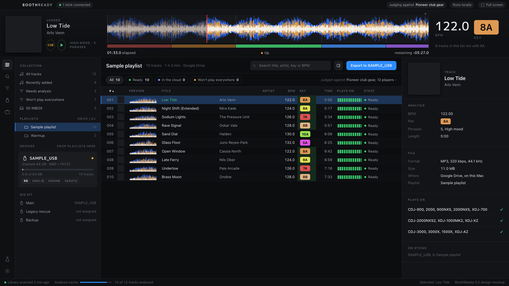
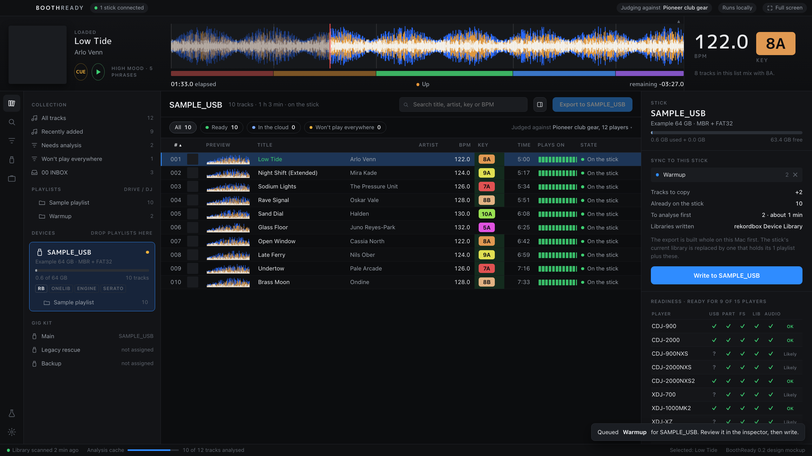
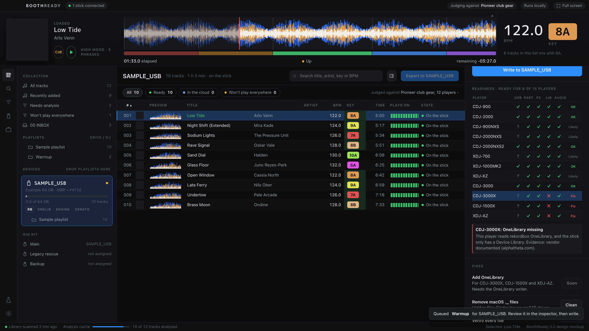

# Redesign devlog

## 19 October 2026: references and first mockup

The current interface was reviewed from its own screenshots (`app/screenshots`, the export-to-USB branch). It reads as a web page: centred columns, large headings, two-line track rows, and the stick on a separate tab from the music.

References looked at: rekordbox 7's EXPORT mode in the product image on rekordbox.com, and Lexicon's library screenshot on lexicondj.com. Taken from rekordbox: the player strip with overview waveform, phrase band and readouts; the narrow icon rail; the tree with devices beside playlists; dense rows with a preview waveform column; green key cells for tracks that mix. Taken from Lexicon: Camelot key pills in wheel colours and a calmer list with chips. The direction is written up in `LIBRARY-REDESIGN.md`.

`mockup/index.html` is a working, self-contained mockup of the new window. It draws the analysis BoothReady itself writes: the three-band overview from the `PWV7` section of each track's `.2EX` file, the row previews from the same data, and the phrase band from `PSSI`. The first pass used the colour waveform (`PWV5`) and came out pink; the three-band data in low, mid, high order gives rekordbox's blue lows, amber mids and white highs.

The mockup reads real library data from `local-data/mockup-data.js`, which is git-ignored, so the screenshots in this folder use the built-in sample (`?sample`) and show invented tracks.

The stick inspector replaces the old report page: capacity, the sync queue built by dragging playlists onto the stick or pressing Export, and the readiness matrix with a reason line for the selected player.

Fixes made while looking at the captures: the state column clipped at 1440 px, the track number column was too narrow, the inspector's full-width artwork pushed the details below the fold, the queue row's dot stretched into a bar, and the matrix verdicts clipped.

Open: the mockup has no light theme yet, drag and drop is wired but untested with a real pointer, and the Kingston stick's playlists show without artwork or keys because only the exported playlist has analysis.

## 19 October 2026: bigger, and filling the screen

Feedback on the first mockup: too tight and too small, and it should use the whole screen. The first pass copied rekordbox's laptop density (12 px text, 24 px rows) and was captured at 1440 x 900, which leaves a small window on a 2560 x 1440 display.

The base size went up throughout: 13.5 px text, 32 px rows, a 176 px player strip with 136 px artwork, a 104 px overview waveform and 44 px BPM digits, and wider tree and inspector panels. The window now scales with the screen from a 1900 px design width, so a 2560 px display draws everything about 35% larger, and there is a full-screen toggle on F. On a laptop-sized window the list first overflowed under the inspector; it now drops the plays-on and preview columns when narrow, and the inspector starts hidden there and opens when a stick is selected or a playlist is queued. The screenshots in this folder are now 2560 x 1440.

